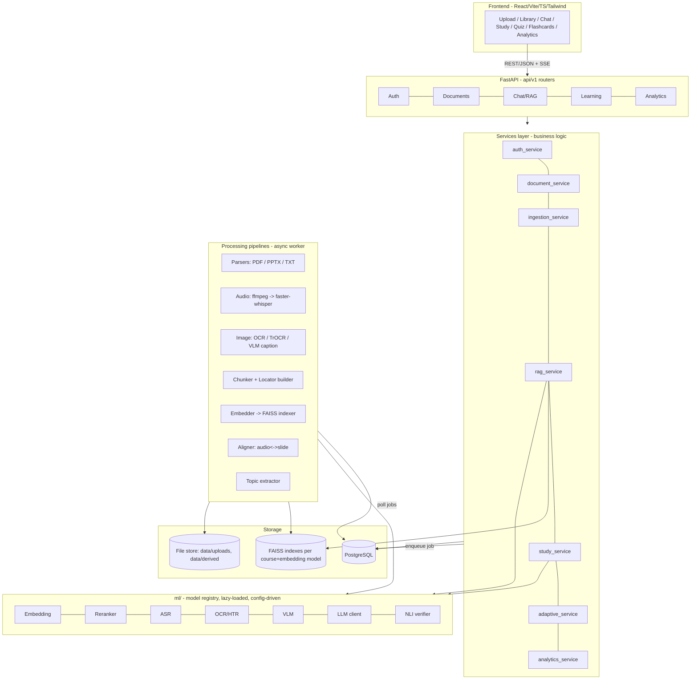
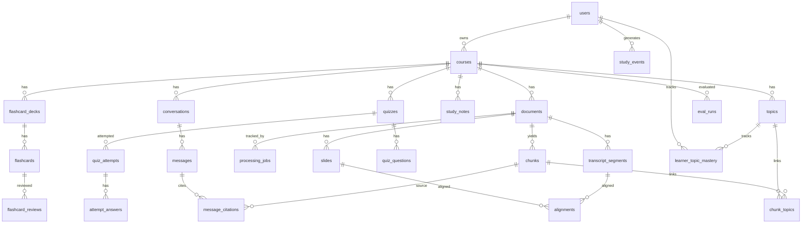

# ARCHITECTURE.md

Status: DESIGN COMPLETE (no code yet). Any deviation requires an ADR in DECISIONS.md.

## 1. Architecture Diagram (Mermaid)


## 2. Layers & Responsibilities
| Layer | Package | Responsibility | Must NOT |
|---|---|---|---|
| API | `app/api/v1/` | HTTP, validation (Pydantic), auth deps, status codes | contain business logic |
| Schemas | `app/schemas/` | Pydantic request/response models | touch DB |
| Services | `app/services/` | Business logic, orchestration, transactions | load ML models directly |
| Models/DB | `app/db/` | SQLAlchemy models, session, Alembic | business logic |
| ML | `app/ml/` | Thin wrappers around pretrained models behind interfaces; model registry; lazy load; device selection | know about DB |
| Pipelines | `app/pipelines/` | Ingestion steps (parse→chunk→embed→index) as composable, idempotent steps | HTTP |
| RAG | `app/rag/` | Query rewrite, hybrid retrieve, rerank, context build, generation, citation verify | DB writes beyond logging |
| Learning | `app/learning/` | Notes, summaries, quiz gen, flashcards, SM-2, mastery, difficulty selection | — |
| Analytics | `app/analytics/` | Event aggregation, metrics | — |
| Workers | `app/workers/` | Job runner polling `processing_jobs` | — |
| Core | `app/core/` | Config (pydantic-settings), security (JWT), logging, errors | — |

## 3. Key Design Patterns
- **Interface + implementation per ML capability** (`EmbeddingModel`, `Reranker`, `ASRModel`, `OCRModel`, `VLM`, `LLMClient`, `NLIVerifier`). Models chosen by config (`.env` / `settings.py`), enabling the embedding comparison study without code changes.
- **Lazy model loading + single process-level cache** to keep RAM low.
- **Unified `chunks` table** for all modalities with a JSON `locator` (e.g. `{"type":"pdf","page":4}`, `{"type":"slide","slide":7}`, `{"type":"audio","start":132.4,"end":171.0}`, `{"type":"image","bbox":[..]}`).
- **FAISS index per (course_id, embedding_model_id)**; vector id = `chunks.id`. Metadata/BM25 live in PostgreSQL/in-memory; FAISS is rebuildable from DB (stored embeddings optional as `.npy`).
- **Job table, not Celery** (v1): `processing_jobs` polled by a worker process. Upgrade path to RQ/Arq/Celery documented in ADR-005.
- **LLM provider abstraction**: default local (Ollama/llama.cpp, OpenAI-compatible endpoint). Optional hosted API via same interface (developer decides; never hard-coded keys).
- **Idempotent pipeline steps** with `status` per step so failed jobs resume.

## 4. Ingestion Flow
1. `POST /documents` → save file, row `documents(status=uploaded)`, job `ingest`.
2. Worker: detect type → parse (PDF pages / PPTX slides+notes / TXT / audio→transcript segments / image→OCR+caption).
3. Chunk (structure-aware) → `chunks` rows with locators.
4. Embed chunks → add to FAISS index; store index version.
5. (Course-level, after N docs) extract topics (cluster + LLM label); if lecture audio and slides both exist → alignment job.
6. `documents.status=ready`.

## 5. RAG Flow
`question` → history-aware rewrite → dense top-k (FAISS) ∥ BM25 top-k → RRF fusion → cross-encoder rerank → context pack with ids `[S1..Sn]` → LLM prompt (answer ONLY from context, cite ids, say "not enough evidence" otherwise) → parse citations → (optional) NLI per-claim support check → response `{answer, citations[{chunk_id, locator, snippet, score}], confidence, abstained}` → log `messages` + `message_citations`.

## 6. Database Schema (PostgreSQL via SQLAlchemy; all PKs UUID unless noted; all tables have `created_at`, `updated_at`)

### Tables (columns)
- **users**: id, email (unique), password_hash, full_name, role (`student|admin`), is_active.
- **courses**: id, owner_id→users, title, description, embedding_model_id (active index), settings JSONB.
- **documents**: id, course_id, filename, mime_type, modality (`pdf|pptx|audio|image|text`), file_path, sha256 (dedupe), size_bytes, status (`uploaded|processing|ready|failed`), error, meta JSONB (pages, duration_s, etc.).
- **processing_jobs**: id, document_id (nullable for course-level jobs), course_id, job_type (`ingest|embed|topics|align|notes|...`), status (`queued|running|done|failed`), step, progress (0-100), attempts, error, payload JSONB, started_at, finished_at.
- **slides**: id, document_id, slide_no, title, body_text, notes_text, image_path.
- **transcript_segments**: id, document_id, idx, start_s, end_s, text, avg_logprob, language.
- **chunks**: id, course_id, document_id, modality, text, locator JSONB, token_count, ordinal, content_hash, embedding_model_id, faiss_id (bigint, indexed), meta JSONB. Indexes: (course_id), (document_id, ordinal), GIN on `to_tsvector(text)` (optional).
- **embedding_models**: id (slug, PK), hf_name, dim, normalize, version, created_at. (supports comparison study)
- **topics**: id, course_id, label, description, keywords TEXT[], centroid (bytea/array, optional), parent_id (nullable).
- **chunk_topics**: chunk_id, topic_id, weight.
- **alignments**: id, course_id, slide_id, segment_id, score, method (`dtw|argmax|viterbi`), is_manual_gold (bool).
- **conversations**: id, user_id, course_id, title.
- **messages**: id, conversation_id, role (`user|assistant|system`), content, retrieval JSONB (queries, k, scores), confidence, abstained, model_name, latency_ms.
- **message_citations**: id, message_id, chunk_id, marker (e.g. `S1`), score, supported (bool null), nli_score.
- **study_notes**: id, course_id, topic_id (nullable), document_id (nullable), kind (`notes|summary`), title, content_md, source_chunk_ids UUID[], model_name.
- **quizzes**: id, course_id, topic_id (nullable), title, kind (`mcq|short|exam`), generated_by (model).
- **quiz_questions**: id, quiz_id, topic_id, qtype, stem, options JSONB, correct_answer, explanation, bloom_level, difficulty_est (0-1 LLM prior), difficulty_emp (0-1 from attempts), source_chunk_ids UUID[].
- **quiz_attempts**: id, quiz_id, user_id, started_at, finished_at, score.
- **attempt_answers**: id, attempt_id, question_id, given_answer, is_correct, time_s.
- **flashcard_decks**: id, course_id, topic_id, title.
- **flashcards**: id, deck_id, front, back, source_chunk_ids UUID[].
- **flashcard_reviews**: id, flashcard_id, user_id, quality (0-5), ease, interval_days, repetitions, due_at, reviewed_at.
- **learner_topic_mastery**: user_id, topic_id (composite PK), mastery (0-1), attempts, last_updated, model (`bkt|elo`).
- **study_events**: id, user_id, course_id, event_type, payload JSONB, ts. (analytics source)
- **eval_runs**: id, course_id, experiment (`retrieval|alignment|faithfulness|adaptive`), config JSONB, metrics JSONB, created_at.

## 7. Model Selection Table
All entries are **candidates**; licenses/sizes are from the developer-side knowledge as of mid-2026 and are `UNVERIFIED` — confirm on each model card at implementation (Batch for that module). Newer models may exist; the registry design makes swapping cheap.

| Capability | Default (CPU-friendly) | Alternatives / compare | Size (approx.) | License (verify) | Notes |
|---|---|---|---|---|---|
| Embeddings | `BAAI/bge-small-en-v1.5` | `sentence-transformers/all-MiniLM-L6-v2`, `bge-base-en-v1.5`, `intfloat/e5-small-v2`, `multilingual-e5-small` (if non-English) | 22M–110M | MIT / Apache-2.0 | all in the comparison study; use query-instruction prefixes where required |
| Lexical baseline | BM25 (`rank_bm25`) | — | — | Apache-2.0 | hybrid via RRF |
| Reranker | `cross-encoder/ms-marco-MiniLM-L-6-v2` | `BAAI/bge-reranker-base` | 22M–280M | Apache-2.0 / MIT | rerank top 20→5; optional toggle |
| ASR | `faster-whisper` (CTranslate2) Whisper `small` int8 | `base`, `medium` (slower), `distil-*` | 74M–770M | MIT | CPU int8; VAD filter; word/segment timestamps; fall back to `openai-whisper` |
| Printed OCR | Tesseract (`pytesseract`) or `PaddleOCR` | `EasyOCR` | small | Apache-2.0 | Tesseract needs system install; choose by accuracy test |
| Handwriting (HTR) | `microsoft/trocr-base-handwritten` (line-level; needs line segmentation) | VLM-based transcription | ~330M | MIT | slow on CPU; run per line crops |
| Image understanding (VLM) | `HuggingFaceTB/SmolVLM-500M-Instruct` (or 256M) | `Qwen2-VL-2B-Instruct`, `microsoft/Florence-2-base` | 0.25–2B | Apache-2.0 / MIT | CPU feasible for single images; diagrams/figures captioning |
| Answer LLM (local) | `Qwen2.5-1.5B-Instruct` GGUF Q4 via Ollama/llama.cpp | `Phi-3.5-mini-instruct` (MIT), `Llama-3.2-3B-Instruct` (Llama license), `Qwen2.5-3B/7B` | 1.5–7B | Apache-2.0 (1.5B/7B) — 3B differs; verify | quality vs speed trade-off; 7B needs ≥16 GB RAM |
| Answer LLM (optional hosted) | via OpenAI-compatible/Anthropic API | — | — | provider ToS | optional, key from env, off by default |
| NLI verifier | `cross-encoder/nli-deberta-v3-small` | `MoritzLaurer/DeBERTa-v3-base-mnli-fever-anli` | 44–184M | Apache-2.0 / MIT | claim-support scoring for faithfulness |
| Topic modelling | embeddings + KMeans/HDBSCAN (+ LLM label) | BERTopic | — | BSD/Apache/MIT | |
| PDF parsing | `pypdf` + `pdfplumber` | `PyMuPDF` (**AGPL** – avoid unless project is AGPL-compliant) | — | BSD/MIT | scanned PDFs → rasterize → OCR (`pdf2image` needs poppler) |
| PPTX parsing | `python-pptx` | — | — | MIT | slide text, notes, images; slide thumbnails via LibreOffice (optional) |
| Audio decode | `ffmpeg` (system) | — | — | LGPL/GPL (tool) | |
| Vector search | `faiss-cpu` (IndexFlatIP / HNSW) | pgvector (rejected, see ADR-003) | — | MIT | cosine via normalized IP |

## 8. Folder Structure
```
mm-learning-companion/
├── CLAUDE.md  PROJECT_CONTEXT.md  ARCHITECTURE.md  IMPLEMENTATION_PLAN.md
├── PROGRESS.md  TASK_LOG.md  DECISIONS.md  API_DOCUMENTATION.md
├── TESTING.md  SETUP.md  KNOWN_ISSUES.md  RESEARCH_NOTES.md  README.md
├── docker-compose.yml            # PostgreSQL (+ optional pgadmin)
├── .env.example  .gitignore  Makefile
├── backend/
│   ├── pyproject.toml            # or requirements/{base,ml-cpu,dev}.txt (see ADR-006)
│   ├── alembic.ini  alembic/versions/
│   ├── app/
│   │   ├── main.py
│   │   ├── core/    (config.py security.py logging.py errors.py deps.py)
│   │   ├── db/      (base.py session.py models/*.py)
│   │   ├── schemas/ (auth.py document.py chat.py study.py quiz.py ...)
│   │   ├── api/v1/  (auth.py courses.py documents.py search.py chat.py notes.py quizzes.py flashcards.py learning.py analytics.py health.py)
│   │   ├── services/ (auth_service.py document_service.py ingestion_service.py rag_service.py study_service.py adaptive_service.py analytics_service.py)
│   │   ├── ml/      (registry.py base.py embeddings.py reranker.py asr.py ocr.py htr.py vlm.py llm.py nli.py)
│   │   ├── pipelines/ (parsers/{pdf,pptx,text}.py audio.py image.py chunker.py indexer.py aligner.py topics.py)
│   │   ├── rag/     (retriever.py bm25.py fusion.py context.py prompts.py generator.py citations.py verifier.py)
│   │   ├── learning/ (notes.py summaries.py quizgen.py flashcards.py sm2.py mastery.py difficulty.py)
│   │   ├── analytics/ (events.py aggregates.py)
│   │   └── workers/ (runner.py)
│   ├── tests/   (unit/ integration/ fixtures/ conftest.py)
│   ├── scripts/ (init_db.py seed_demo.py reindex.py)
│   └── data/    (uploads/ derived/ faiss/ models_cache/)   # gitignored
├── frontend/
│   ├── package.json vite.config.ts tailwind.config.ts tsconfig.json
│   └── src/ (main.tsx App.tsx api/ components/ pages/ hooks/ store/ types/ tests/)
└── research/
    ├── datasets/  eval/ (retrieval_eval.py alignment_eval.py faithfulness_eval.py adaptive_sim.py)
    ├── notebooks/ results/ figures/
    └── README.md
```

## 9. Hardware Recommendations
| Tier | Spec | What works |
|---|---|---|
| Minimum | 8 GB RAM, 4-core CPU, 30 GB free SSD | embeddings (small), Whisper `base`, Tesseract, 0.5–1.5B LLM (slow) |
| **Recommended dev** | 16 GB RAM, 6–8 core CPU, 50+ GB SSD | full stack on CPU: Whisper `small` int8, bge-small/base, 1.5–3B LLM Q4, SmolVLM |
| Comfortable | 32 GB RAM or any NVIDIA GPU ≥8 GB | 7B Q4 LLM, Whisper `medium`, faster batch benchmarks |
| Free burst compute (no purchase) | Google Colab / Kaggle notebooks (GPU) | run research benchmarks / large-batch embedding / HTR evals; export results into `research/results/` |
Expect CPU ingestion of a 1-hour lecture to take minutes-to-tens-of-minutes; measure and log in `TESTING.md` benchmarks (do not assume).

## 10. Dependency Strategy
- Python 3.11 (or 3.10–3.12), one venv at `backend/.venv`.
- Split requirements: `base` (FastAPI, SQLAlchemy, Alembic, psycopg, pydantic-settings, auth libs), `ml-cpu` (torch CPU wheel, transformers, sentence-transformers, faiss-cpu, faster-whisper, OCR libs, rank_bm25), `dev` (pytest, httpx, ruff, mypy).
- **Torch CPU** installed from the PyTorch CPU wheel index to avoid multi-GB CUDA downloads.
- **Pin versions only after the first successful install on the developer's machine** (Batch 1 records `pip freeze` into `requirements.lock`). Never invent version numbers in chat.
- ML deps are **optional extras**; the API and tests must run with ML mocked (`ML_BACKEND=fake` for CI/fast tests).
- System deps documented in SETUP.md: ffmpeg, tesseract, poppler, (optional) LibreOffice.
- Model weights downloaded on first use into `backend/data/models_cache` (HF_HOME), gitignored.
- Frontend: Node LTS, npm; Vitest + React Testing Library; Playwright optional.
